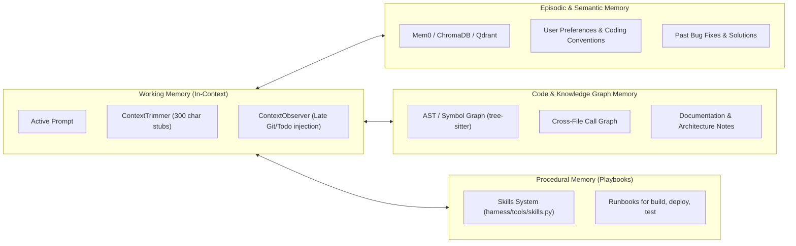

# Harness Architecture & Memory System

A comprehensive overview of the **Agent Harness** architecture and its **Memory Lifecycle**, along with integration patterns for **Mem0** and alternative memory architectures.

---

## 1. System Architecture Diagram

```mermaid
flowchart TD
    subgraph UI ["User & Terminal Interface"]
        CLI["CLI Entrypoint\n(harness/cli/main.py)"]
        TUI["TerminalUI (Rich)\nSteps, Colors, White text,\nNo boxes, No emojis"]
        User(["Developer / User"])
    end

    subgraph Agents ["Multi-Agent Architecture"]
        Orch["AgentOrchestrator\n(agents/orchestrator.py)"]
        Lead["LeadAgent\n(agents/lead.py)"]
        Researcher["ResearcherAgent\n(agents/researcher.py)"]
        Reviewer["ReviewerAgent\n(agents/reviewer.py)"]
        SubAgents["Specialized Subagents\n(agents/subagent.py)"]
    end

    subgraph CoreServices ["Core & Support Services"]
        Config["Settings (Pydantic)\n(core/config.py)"]
        LLM["LLMClient (OpenAI/NIM API)\n(providers/llm.py)"]
        Ledger["CostLedger & Budget\n(services/ledger.py)"]
        Tracer["Execution Tracer\n(services/tracer.py)"]
    end

    subgraph Tools ["Tool Registry & Capabilities"]
        Registry["ToolRegistry\n(tools/base.py)"]
        FS["Filesystem\nread_file, write_file, str_replace"]
        Terminal["Bash / Shell Execution"]
        Browser["Web Search & Scraping\n(parallel.ai)"]
        PlannerTool["write_todos\n(tools/planner.py)"]
        MCP["MCP Client & Servers\n(mcp/client.py)"]
        Desktop["Desktop GUI Automation"]
    end

    subgraph MemorySystem ["Memory Subsystem (harness/memory)"]
        Observer["ContextObserver (observer.py)\nGit Diffs, Clock, Active Todos"]
        Trimmer["ContextTrimmer (trimmer.py)\nDisk Spills, Output Capping,\nHistorical Turn Stripping"]
        Compactor["Compactor (compactor.py)\nProactive Handoff Note\nat Context Window Threshold"]
        SessionMgr["SessionManager (session.py)\nAppend-only JSONL, Rewind,\nSession Restore"]
    end

    User <--> CLI
    CLI <--> TUI
    CLI --> Orch
    Orch --> Lead

    Lead --> Registry
    Registry --> FS
    Registry --> Terminal
    Registry --> Browser
    Registry --> PlannerTool
    Registry --> MCP
    Registry --> Desktop

    Lead <--> LLM
    Lead --> SubAgents
    Lead --> Researcher
    Lead --> Reviewer

    Lead <--> MemorySystem
    Observer -->|Late Context Injection| Lead
    Lead -->|Output Capping & Turn Strip| Trimmer
    Lead -->|Context Threshold Handoff| Compactor
    Lead -->|Persist History| SessionMgr
    
    Lead --> Ledger
    Lead --> Tracer
    Config -.-> CoreServices
```

---

## 2. Memory Lifecycle Sequence

```mermaid
sequenceDiagram
    autonumber
    actor User
    participant Lead as LeadAgent
    participant Obs as ContextObserver
    participant Trim as ContextTrimmer
    participant LLM as LLMClient
    participant Tools as ToolRegistry
    participant Sess as SessionManager
    participant Comp as Compactor

    User->>Lead: Prompt / Request
    Lead->>Obs: build_injection() (Git diff, clock, active plan)
    Lead->>Trim: fit_budget(messages) (emergency shedding if needed)
    
    rect rgb(30, 30, 40)
        note right of Lead: Execution Turn Loop
        Lead->>LLM: complete(messages + injection)
        LLM-->>Lead: Response (Thoughts + Tool Calls)
        Lead->>Sess: save(assistant_message)
        Lead->>Tools: execute(fn_name, args)
        Tools-->>Trim: Raw large output
        Trim-->>Tools: Capped output (spilled to disk if > cap)
        Tools-->>Lead: result
        Lead->>Sess: save(tool_message)
    end

    rect rgb(40, 30, 30)
        note right of Lead: Post-Turn Memory Maintenance
        Lead->>Trim: sweep() (clean up temp files)
        Lead->>Trim: strip_turn(messages) (compress old tool results to 300-char stubs)
        opt Prompt Tokens >= Compact Threshold (e.g. 82%)
            Lead->>Comp: is_needed(usage) == True
            Comp->>LLM: Generate structured handoff note
            LLM-->>Comp: Markdown Handoff (<summary>)
            Comp->>Lead: Compacted messages prefix
            Lead->>Sess: record_compaction(compacted_messages)
        end
    end

    Lead-->>User: Final Response
```

---

## 3. Is It Possible to Use Mem0 Here?

**Yes, absolutely.** In fact, Mem0 is an ideal fit for this harness.

### Why Mem0 Fits
1. **Short-Term vs Long-Term Gap:**
   - Current memory (`compactor.py`, `trimmer.py`, `session.py`) is **working memory** (ephemeral or tied to single transcript sessions).
   - Mem0 provides **episodic & personalized long-term memory** across all developer sessions (e.g., coding preferences, API keys, repository design quirks, common bugs encountered last week).
2. **Entity & Preference Extraction:**
   - When a user says *"always use CMake 3.20"* or *"never modify auth_token in test environment"*, Mem0 extracts and indexes this fact automatically.
3. **Graph Memory (Mem0 Graph):**
   - Can track relationships between files, classes, APIs, and business rules across turns and sessions.

### Where Mem0 Plugs In:
- **Injection:** In `harness/memory/observer.py`, query `mem0.search(user_input)` to fetch relevant facts and inject them into the system prompt or late-injection block.
- **Extraction:** In `harness/agents/lead.py` at the end of each turn, call `mem0.add(messages, user_id="developer")` to asynchronously extract learned facts.

---

## 4. Proposed Memory Architectures to Add

| Memory Architecture | Technology / Library | Purpose in this Harness |
| :--- | :--- | :--- |
| **Long-Term Fact & Preference Memory** | **Mem0** | Remembers developer instructions, tech stack preferences, and past solutions across separate runs. |
| **Semantic Codebase Search (RAG)** | **ChromaDB / LanceDB / Qdrant** | Replaces brute-force grep with semantic search over function definitions, commits, and PR discussions. |
| **Code Knowledge Graph (GraphRAG)** | **Neo4j / Mem0 Graph / NetworkX** | Tracks dependencies (which file imports what, which API route calls which service) without loading entire files into tokens. |
| **Self-Reflective / Procedural Memory** | **Reflexion / Skill Library** | When a build or test fails and is solved, the harness writes a reusable skill/playbook in `harness/skills/`. |

