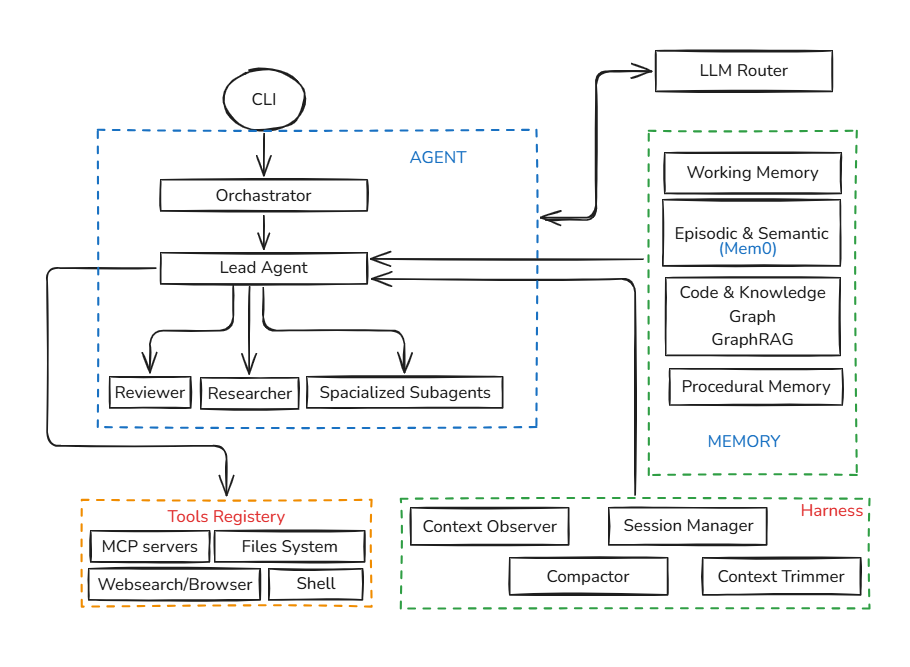

# Cursor Agent Harness

<p align="center">
  
</p>

<p align="center">
  <strong>Production-grade, multi-agent autonomous software engineering harness with multi-tiered cognitive memory and MCP integration.</strong>
</p>

<p align="center">
  <a href="https://github.com"></a>
</p>

<p align="center">
  
  
  
  
  
  
  
</p>

---

## Demo Video

<p align="center">
  <a href="#quickstart">
    
    <br/>
    <em>Click to watch: Full Autonomous End-to-End Coding Session Demo</em>
    <br/>
    <sub>(Watch the agent diagnose failing tests, orchestrate research subagents, cap context spills, and commit fixes autonomously)</sub>
  </a>
</p>

```bash
# Quick preview run
$ agent-harness --prompt "Refactor VPN socket client and add connection retry with exponential backoff"
```

---

## What is Cursor Agent Harness?

**Cursor Agent Harness** is an enterprise-grade execution framework designed for autonomous coding agents. Unlike naive single-prompt script wrappers, the harness incorporates a **Hierarchical Multi-Agent Engine**, **Dynamic Context Lifecycle Management**, and an extensible **Cognitive Memory Subsystem** inspired by state-of-the-art coding assistants like Cursor and Devin.

It isolates execution contexts, controls token bloat via proactive disk spilling, and coordinates specialized subagents (Reviewers, Researchers, Domain Specialists) with real-world tool execution (Model Context Protocol, Shell, Filesystem, Planner).

---

## Key Features

- **Hierarchical Multi-Agent Orchestration**: Decoupled **Orchestrator -> Lead Agent -> Subagents** (Reviewer, Researcher, Domain Coders) for coordinated problem solving.
- **Multi-Tiered Memory Architecture**:
  - **Working Memory**: Real-time context injection (`Git diff`, terminal clock, live plan state).
  - **Context Trimmer**: Disk spilling for large CLI outputs (`>20k chars`) with automatic sweep and turn-stripping.
  - **Context Compactor**: Proactive handoff note generation at high token thresholds (`82%`).
  - **Episodic & Semantic Memory (Mem0 / GraphRAG Ready)**: Cross-session retention of user coding preferences and codebase quirks.
- **Model Context Protocol (MCP) & Extensible Tools**: Native support for Stdio MCP servers, filesystem read/write, bash terminal execution, web search, and todo planner.
- **Token & Budget Control**: In-flight token tracking, per-model cost computation via `CostLedger`, and emergency token shedding.
- **Product-Grade Terminal UX**: Built with `Rich`, featuring structured step rendering, clean monochrome outputs, progress status spinners, and zero clutter.

---

## System Architecture

<p align="center">
  
</p>

The system operates across distinct decoupled layers:
- **CLI / UI**: TerminalUI built on top of Rich without noisy artifacts.
- **Agent Orchestration**: Orchestrator delegates tasks to the Lead Agent, which in turn provisions Reviewer, Researcher, and specialized subagents.
- **Model Gateway (LLM Router)**: Dispatches prompts across models (OpenAI, NVIDIA NIM, Anthropic).
- **Tools Registry**: Direct integrations with MCP servers, Host Filesystem, Shell execution, and Web Search.
- **Harness Context Lifecycle**: Context Observer (diff & clock injection), Context Trimmer (disk spilling & output capping), Compactor (context threshold handoffs), and Session Manager (JSONL history rewind).
- **Memory Subsystem**: Working memory, Episodic & Semantic Memory (Mem0), Code & Knowledge Graphs (GraphRAG), and Procedural Memory rules.

For an in-depth technical deep dive on memory integrations, see [ARCHITECTURE_AND_MEMORY.md](./ARCHITECTURE_AND_MEMORY.md).

---

## Quickstart

### 1. Installation

```bash
# Clone the repository
git clone https://github.com/your-org/cursor-agent-harness.git
cd cursor-agent-harness

# Create and activate virtual environment
python -m venv .venv
source .venv/bin/activate  # On Windows: .venv\Scripts\activate

# Install in editable mode
pip install -e .
```

### 2. Environment Configuration

Create a `.env` file in the root directory:

```env
OPENAI_API_KEY="your-api-key"
OPENAI_BASE_URL="https://api.openai.com/v1"
MODEL_NAME="gpt-4o"
MAX_TURNS=30
CONTEXT_WINDOW_LIMIT=128000
COMPACT_THRESHOLD=0.82
```

### 3. Launching the Agent

```bash
# Interactive REPL session
agent-harness

# Execute single directive autonomously
agent-harness --prompt "Investigate the failing unit tests in tests/test_harness.py and fix them"
```

---

## Repository Structure

```
coding harness/
├── docs/
│   ├── README.md                  # Project documentation
│   ├── ARCHITECTURE_AND_MEMORY.md # Technical breakdown & Mem0 architecture
│   └── architecture.png           # Architecture diagram asset
├── harness/
│   ├── agents/                    # Multi-agent implementations (Lead, Researcher, Reviewer)
│   ├── cli/                       # Typer-powered CLI interface
│   ├── core/                      # Configuration, settings & logging
│   ├── memory/                    # Observer, Trimmer, Compactor, Session Manager
│   ├── providers/                 # LLM provider abstractions (OpenAI, NIM, etc.)
│   ├── services/                  # Cost ledger, token counter, tracer
│   ├── tools/                     # Bash, filesystem, planner, browser
│   └── ui/                        # Terminal Rich interface & event rendering
├── mcp_config.json                # Model Context Protocol servers configuration
└── pyproject.toml                 # Package definition and dependencies
```

---

## Configuration & MCP Integration

Model Context Protocol (MCP) servers can be configured via `mcp_config.json`:

```json
{
  "mcpServers": {
    "git": {
      "command": "uvx",
      "args": ["mcp-server-git", "--repository", "."]
    },
    "fetch": {
      "command": "uvx",
      "args": ["mcp-server-fetch"]
    }
  }
}
```

---

## Contributing

Contributions are warmly welcomed. Please check out our [Contributing Guide](CONTRIBUTING.md) and submit pull requests to help improve the agent harness.

---

## License

This project is licensed under the [MIT License](LICENSE).
